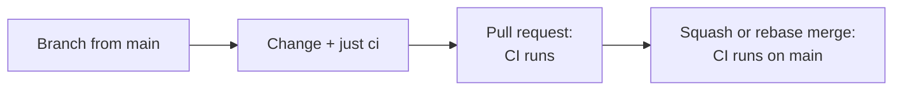
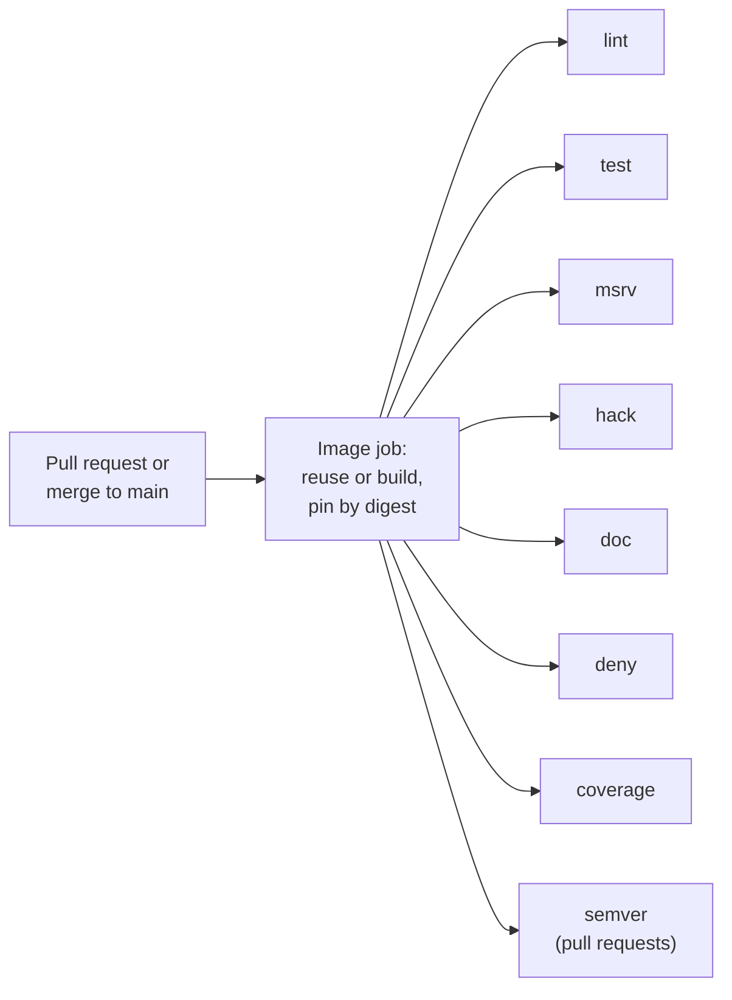
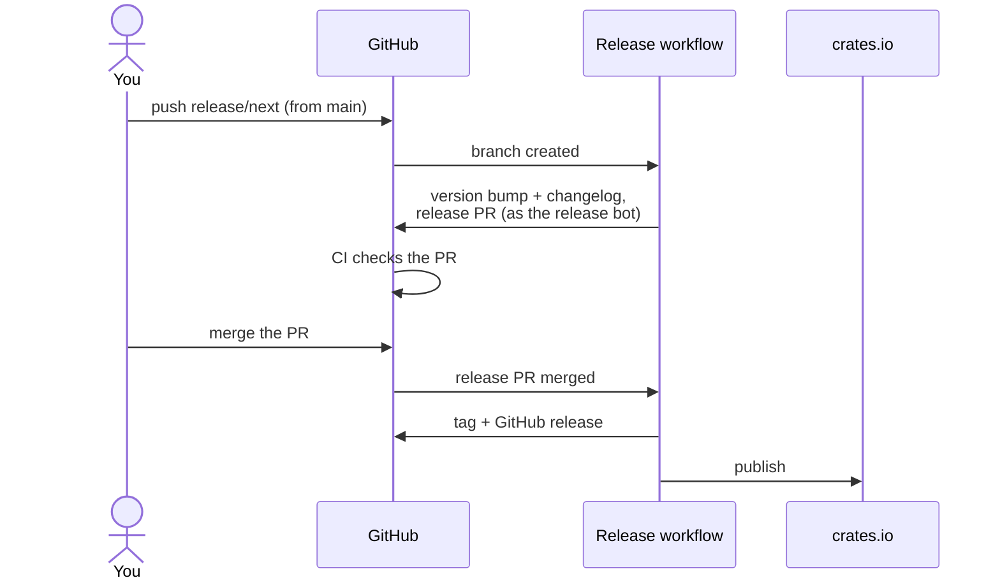

# {{project-name}} development guide

This guide explains how this project is built, checked and released, and
how to work on it: every command, check, workflow and tool, what each is
for, and how to change it.

**How it fits together:** every tool is pinned inside one container image
(the devcontainer), every check is a `just` command, and CI runs the same
commands in the same image. A check that passes on your machine passes in
CI, and any CI failure can be reproduced with one command.

**Contents**

1. [Getting started](#getting-started)
2. [Making a change](#making-a-change)
3. [Commands](#commands)
4. [Checks in detail](#checks-in-detail)
5. [CI workflows](#ci-workflows)
6. [The protected `main` branch](#the-protected-main-branch)
7. [Releases](#releases)
8. [Dependency updates](#dependency-updates)
9. [The devcontainer](#the-devcontainer)
10. [Security measures](#security-measures)
11. [Project rules](#project-rules)
12. [Tools](#tools)
13. [Configuration files](#configuration-files)
14. [Troubleshooting](#troubleshooting)

## Getting started

### With the devcontainer (recommended)

The devcontainer is a Docker image with every toolchain and tool this project
uses, at exactly the versions CI uses. Working inside it means a check that
passes on your machine also passes in CI.

- **VS Code:** install Docker and the
  [Dev Containers](https://marketplace.visualstudio.com/items?itemName=ms-vscode-remote.remote-containers)
  extension, open the repository folder, and choose **Reopen in Container**.
- **GitHub Codespaces:** on the repository page, choose *Code* → *Codespaces*
  → *Create codespace*. Nothing needs to be installed locally.

The first build downloads and installs everything and takes several minutes;
after that the container starts in seconds. When it's created it runs
`just setup`, which:

- creates `Cargo.lock` if it doesn't exist (commit it: CI requires it);
- installs the git hook that checks formatting and spelling before each commit.

Then check that everything passes:

```sh
just ci
```

### Without the devcontainer

1. Install Rust with [rustup](https://rustup.rs). Inside the repository,
   rustup reads `rust-toolchain.toml` and installs the pinned version
   automatically.
2. Install the [tools](#tools) at the versions listed in
   `.devcontainer/tools.toml` (for example with
   [cargo-binstall](https://github.com/cargo-bins/cargo-binstall):
   `cargo binstall just@<version> cargo-nextest@<version> ...`).
3. Run `just setup`, then `just ci`.

Versions that differ from `tools.toml` may give different results from CI.

## Making a change



1. **Create a branch** from an up-to-date `main`. `main` itself only accepts
   pull requests (see [The protected `main` branch](#the-protected-main-branch)).

   ```sh
   git switch main && git pull
   git switch -c fix/overflow-message
   ```

2. **Make the change.** Run `just fmt` to format, and the relevant checks
   while you work (`just test`, `just lint`).
3. **Commit** using [Conventional Commits](#commit-messages), e.g.
   `fix: report overflow instead of panicking`. The git hook checks
   spelling in the files you're committing and, when they include Rust or
   TOML files, the formatting of the whole repository.
4. **Run `just ci`** before pushing. It runs everything CI runs on a pull
   request.
5. **Push and open a pull request.** CI runs every check. Fix anything that
   fails; each failing job names the `just` command to reproduce it.
6. **Merge** with **Squash and merge** or **Rebase and merge** once CI
   passes. Merge commits are blocked. CI runs again on `main`.

Nothing is released by merging. Releases are a separate, deliberate step
(see [Releases](#releases)).

## Commands

Every check is a [`just`](https://just.systems) command defined in the
`justfile`. CI runs these same commands, so the `justfile` is the single
place where each command is written. Run `just` to list them.

| Command | What it does |
|---|---|
| `just setup` | One-time setup: creates `Cargo.lock` if missing and installs the git hook |
| `just ci` | Every check CI runs on a pull request: `lint`, `test`, `msrv`, `hack`, `doc`, `deny`, `cov`, `semver` |
| `just fmt` | Formats all Rust and TOML files in place |
| `just lint` | Formatting check, clippy, TOML formatting check, spelling, workflow audit |
| `just fmt-check` / `just clippy` / `just toml-check` / `just typos` / `just zizmor` | The individual parts of `just lint` |
| `just test` | Unit, integration and doc tests (including the README's examples) |
| `just msrv` | Builds the library with the oldest supported Rust version |
| `just hack` | Checks every combination of feature flags |
| `just doc` | Builds the docs the way docs.rs does; warnings are errors |
| `just doc-open` | Builds the docs and opens them in a browser |
| `just deny` | Checks dependency licenses, security advisories, bans and sources |
| `just cov` | Measures test coverage; writes `target/lcov.info` and prints a summary |
| `just semver [baseline]` | Fails if the public API breaks compared with `baseline` (default `origin/main`) |
| `just test-latest` | Updates `Cargo.lock` to the newest compatible dependencies, then tests |
| `just test-toolchain <name>` | Tests on another toolchain, e.g. `just test-toolchain beta` |
| `just bench [args]` | Runs the benchmarks; e.g. `just bench -- --save-baseline main` |
| `just miri` | Runs the tests under Miri to detect undefined behaviour |
| `just fuzz [seconds]` | Runs each fuzz target for the given time (default 60 seconds each) |

## Checks in detail

Each check below lists what it catches, how to run it, where it's
configured, and how to change it.

### Formatting

- **Catches:** Rust and TOML files that aren't formatted consistently.
- **Run:** `just fmt` to fix, `just fmt-check` and `just toml-check` to check.
- **Configured in:** `rustfmt.toml` (Rust; stable options only, so no
  nightly is needed), `taplo.toml` (TOML), `.editorconfig` (indentation,
  line endings and final newlines for every editor).
- **In VS Code:** files are formatted on save with the same configs.

### Lints

- **Catches:** likely bugs, unidiomatic code, missing documentation and
  leftover debugging code.
- **Run:** `just clippy`. CI treats every warning as an error.
- **Configured in:** `Cargo.toml` under `[lints]`, plus `clippy.toml`.
- **Rules:**
  - clippy's `pedantic` group (stricter style and correctness lints);
  - every public item must be documented (`missing_docs`), and public types
    must implement `Debug` (`missing_debug_implementations`);
  - no `dbg!`, `todo!`, `unimplemented!`, `println!` or `eprintln!` left in
    library code; tests may use them, and may also `unwrap`, `expect` and
    `panic` (`clippy.toml`);
  - no `pub` items that can't actually be reached from outside the crate
    (`unreachable_pub`), and no needlessly qualified paths;

  - `unsafe` code is denied unless a module opts in with
    `#[allow(unsafe_code)]`; every `unsafe` block needs a `// SAFETY:`
    comment explaining why it's sound, each block may contain only one
    unsafe operation, and every `unsafe fn` needs a `# Safety` doc section.

  - `unsafe` code is forbidden.

- **Change:** adjust levels in `[lints]`. To allow a lint in one place, use
  `#[allow(clippy::lint_name, reason = "why")]` on that item.

### Spelling

- **Catches:** typos in code, comments and docs.
- **Run:** `just typos` (also runs on staged files before each commit).
- **Change:** if a correct word is flagged, add it to `typos.toml` under
  `[default.extend-words]`.

### Workflow audit

- **Catches:** security problems in the GitHub Actions workflows, such as
  unpinned actions, excessive permissions or script injection.
- **Run:** `just zizmor`. Tool: [zizmor](https://docs.zizmor.sh).
- **Change:** fix the reported problem; if a finding is a false positive,
  add `# zizmor: ignore[<audit>]` with a comment explaining why (see the
  `container.image` lines in the workflows for an example).

### Tests

- **Catches:** behaviour that doesn't match expectations.
- **Run:** `just test`. It runs unit tests (in `src/`) and integration tests
  (in `tests/`) with [cargo-nextest](https://nexte.st), then the doc tests:
  the examples in doc comments and in `README.md`, so the README's usage
  example always compiles and works.
- **Configured in:** `.config/nextest.toml`. A test running longer than
  30 seconds is reported as slow and stopped after 2 minutes. In CI
  (`NEXTEST_PROFILE=ci`), all tests run even after a failure and only
  failures print output.

### Coverage

- **Shows:** which lines, functions and branches the tests exercise.
- **Run:** `just cov`. It writes `target/lcov.info` (for editors and
  other coverage tools) and prints a summary table. Doc tests aren't counted.
- **In CI:** the summary appears on the run's summary page.

### Minimum supported Rust version (MSRV)

- **Catches:** use of language features or standard library APIs newer than
  the oldest Rust version the crate promises to support.
- **Run:** `just msrv`. It installs the version from `rust-version` in
  `Cargo.toml` if needed and builds the library with all features. Tests
  and examples aren't built, because development dependencies may need a
  newer Rust.
- **Change:** see [Supported Rust versions](#supported-rust-versions).

### Feature combinations

- **Catches:** code that only compiles with a particular set of Cargo
  features enabled.
- **Run:** `just hack`. [cargo-hack](https://github.com/taiki-e/cargo-hack)
  checks every combination of features (the "powerset"). With no features
  defined, this is a single build.

### Documentation

- **Catches:** broken doc links, invalid doc syntax and any rustdoc warning.
- **Run:** `just doc`, or `just doc-open` to read the result.
- **How:** builds with the pinned nightly and `--cfg docsrs`, exactly as
  docs.rs will. Items behind a feature flag are labelled with the feature
  they need (`doc_cfg`). The docs.rs settings are in `Cargo.toml` under
  `[package.metadata.docs.rs]`.

### Dependency audit

- **Catches:** dependencies with known vulnerabilities, unmaintained or
  unsound crates, yanked versions, disallowed licenses, version wildcards,
  and crates from anywhere other than crates.io.
- **Run:** `just deny`. Tool: [cargo-deny](https://embarkstudios.github.io/cargo-deny/).
- **Configured in:** `deny.toml`.
  - **Licenses allowed:** MIT, MIT-0, Apache-2.0 (with or without the LLVM
    exception), BSD-2-Clause, BSD-3-Clause, ISC, Unicode-3.0, Zlib.
  - **Duplicate versions** of the same crate are reported as warnings.
- **Change:** to allow another license, add it to `allow` in `[licenses]`.
  To accept a specific advisory, add its ID to `ignore` in `[advisories]`
  with a comment saying why.

### API compatibility (semver)

- **Catches:** changes to the public API that would break code using the
  crate, such as removing or renaming a public item.
- **Run:** `just semver` compares with `origin/main`; `just semver <ref>`
  compares with another git ref. Tool:
  [cargo-semver-checks](https://github.com/obi1kenobi/cargo-semver-checks).
- **What a failure means:** the change is breaking. That's allowed, but the
  commit must say so (`feat!:` or a `BREAKING CHANGE:` footer) so the next
  release gets the right version number. That's why this check is not
  required for merging.
- **Limitation:** it catches removed and renamed items, but not every kind
  of break; for example, a changed parameter type isn't detected.


### Miri

- **Catches:** undefined behaviour in `unsafe` code, such as out-of-bounds
  access, use after free, invalid alignment or data races.
- **Run:** `just miri`. It runs the tests (including doc tests) in
  [Miri](https://github.com/rust-lang/miri), an interpreter that checks every
  memory operation. It's much slower than normal tests.



### Fuzzing

- **Catches:** crashes, panics and failed assertions on unexpected input.
- **Run:** `just fuzz` runs each target for 60 seconds; `just fuzz 3600`
  runs each for an hour. Tool:
  [cargo-fuzz](https://rust-fuzz.github.io/book/cargo-fuzz.html) with libFuzzer.
- **Where:** targets live in `fuzz/fuzz_targets/`; each is listed as a
  `[[bin]]` in `fuzz/Cargo.toml`. The fuzz crate is separate from the main
  crate because it needs nightly.
- **Add a target:** create `fuzz/fuzz_targets/<name>.rs` and add a matching
  `[[bin]]` entry.
- **When it finds a crash:** the input is saved in `fuzz/artifacts/<target>/`.
  Reproduce it with
  `cargo +<nightly> fuzz run --target x86_64-unknown-linux-gnu <target> <file>`
  (the nightly version is in `.devcontainer/tools.toml`; use
  `aarch64-unknown-linux-gnu` on ARM). In CI, crash inputs are uploaded as
  the `fuzz-artifacts` artifact.



### Benchmarks

- **Measures:** how fast the code runs, with statistics to tell real
  changes from noise.
- **Run:** `just bench`. Benchmarks use
  [criterion](https://bheisler.github.io/criterion.rs/book/) and live in
  `benches/`; each is listed as a `[[bench]]` in `Cargo.toml`.
- **Compare changes:** `just bench -- --save-baseline before` on the old
  code, then `just bench -- --baseline before` on the new code.
- **In CI:** benchmarks are compiled (by clippy) but not run, because shared
  CI machines are too noisy for meaningful timings.


## CI workflows

All workflows are in `.github/workflows/`. Every job that checks code runs
inside the devcontainer image and calls one `just` command, so any failure
can be reproduced locally by running that command in the devcontainer.

| Workflow | Runs when | Jobs |
|---|---|---|
| **CI** (`ci.yml`) | Every pull request, every merge to `main` | `lint`, `test`, `msrv`, `hack`, `doc`, `deny`, `coverage`; on pull requests also `semver` |
| **Miri** (`miri.yml`) | Every pull request, every merge to `main` | `miri` |
| **Fuzz** (`fuzz.yml`) | Every pull request, every merge to `main`; also manually with a chosen duration | `fuzz` |
| **Scheduled** (`scheduled.yml`) | Mondays at 06:00 UTC, or manually | Image rebuild, beta and nightly tests, newest-dependency tests, dependency audit, image cleanup |
| **Release** (`release-plz.yml`) | A `release/*` branch is created; its pull request is merged | Prepare release PR; publish release |
| **Devcontainer image** (`devcontainer.yml`) | Called by the workflows above | Builds or reuses the image |



Each check is a separate job, so a failure names exactly which check
failed.

### How the image is shared between jobs

Each workflow first calls `devcontainer.yml`, which:

1. computes a tag from a hash of everything the image is built from
   (`.devcontainer/` and `rust-toolchain.toml`);
2. reuses the image in the repository's GitHub container registry if that
   tag already exists, or builds and pushes it if not (so it's only rebuilt
   when those files change);
3. hands the other jobs the image's exact digest, so every job runs the
   same image even if the tag is overwritten meanwhile.

Workflows call it with `uses: $/.github/workflows/devcontainer.yml`. The
`$/` prefix is GitHub's self-repository syntax: like `./`, it means this
repository, but it always loads the file from the same commit as the
calling workflow, and GitHub and zizmor treat it as pinned.

### Details

- **Coverage** writes its summary to the run's summary page.
- **semver** only runs on pull requests, comparing with the target branch.
  It isn't a required check (see [API compatibility](#api-compatibility-semver)).
- **Scheduled** catches breakage that happens without any change here:
  - rebuilds the image from scratch, picking up security updates to the base
    image and confirming the Dockerfile still builds;
  - tests on Rust beta and nightly, to hear about upcoming problems early;
  - updates `Cargo.lock` to the newest compatible dependencies and tests
    (`just test-latest`), to catch dependency releases that break the crate;
  - re-runs the dependency audit for newly published advisories;
  - deletes old untagged image versions, keeping the newest five, so
    registry storage doesn't grow forever.
- **Time limits:** every job has one (30 or 60 minutes), so a hung job
  can't run for hours.
- **Superseded runs:** pushing to a pull request cancels its previous CI run.
- **Merge queue:** none is set up, but the pull request workflows also run
  for a [merge queue](https://docs.github.com/en/repositories/configuring-branches-and-merges-in-your-repository/configuring-pull-request-merges/managing-a-merge-queue),
  so you can enable one in the ruleset without changing them.
- **Pauses:** GitHub pauses scheduled workflows after 60 days without
  repository activity; re-enable them from the *Actions* tab.

## The protected `main` branch

`main` is protected by the ruleset in `.github/rulesets/main.json` (imported
once into the repository settings). It enforces:

- **No direct pushes:** every change arrives through a pull request.
- **No force pushes and no deletion** of `main`.
- **Squash or rebase merges only,** keeping history linear (one commit per
  change, no merge commits).
- **Required checks:** `lint`, `test`, `msrv`, `hack`, `doc`, `deny`,
  `coverage`, `miri`, `fuzz` must pass. `semver` is deliberately not required.
- **No approvals required,** so a single maintainer can merge their own
  pull requests once CI passes.
- **No exceptions:** nobody can bypass these rules, administrators included.

To change the rules, edit them in the repository settings (*Settings* →
*Rules* → *Rulesets*), and export them back to `main.json` so the file stays
accurate.

## Releases

Releases are handled by [release-plz](https://release-plz.dev) and only
happen when you start one. Merging ordinary pull requests never releases
anything.



### Making a release

1. **Create a release branch** from an up-to-date `main` and push it. The
   name must start with `release/`; the rest is up to you.

   ```sh
   git switch main && git pull
   git switch -c release/next
   git push -u origin release/next
   ```

2. **release-plz prepares the release** (the *Prepare release PR* job, a
   few minutes):
   - works out the next version from the [commit messages](#commit-messages)
     since the last release, checking the public API with
     cargo-semver-checks so a breaking change can't slip into a minor
     version;
   - updates the version in `Cargo.toml` and `Cargo.lock` and adds a section
     to `CHANGELOG.md` listing the changes;
   - commits that to your branch as `chore(release): v<version>` and opens a
     pull request into `main`, as the release bot.

   If nothing changed since the last release, it stops with a notice and
   opens no pull request.
3. **Review the pull request.** Check the version number and the changelog
   entry; you can edit the changelog on the branch before merging.
4. **Merge it** (squash or rebase) once CI passes. The *Publish release* job
   then:
   - tags the merged commit with the version (e.g. `v0.2.0`);
   - creates a GitHub release with the changelog section as its notes;
   - publishes the crate to crates.io.

### How the version is chosen

Versions follow [Semantic Versioning](https://semver.org). The biggest
change among the commits since the last release decides the bump (see the
table in [Commit messages](#commit-messages)); an API break found by
cargo-semver-checks counts as a breaking change even if no commit says so.

### How publishing is authorised

The release job uses crates.io
[trusted publishing](https://crates.io/docs/trusted-publishing): crates.io
trusts this repository's `release-plz.yml` workflow directly, so no crates.io
token is stored anywhere. The first version of a crate must be published by
hand, because trusted publishing can only be set up for a crate that exists.

### Why a release bot

GitHub deliberately doesn't run workflows for commits and pull requests made
with a workflow's built-in token. Since `main` requires passing CI, a release
pull request opened that way could never be merged. The release workflow
therefore acts as a GitHub App you own (the release bot), configured through
the `RELEASE_APP_CLIENT_ID` variable and `RELEASE_APP_PRIVATE_KEY` secret.
Its token is limited to repository contents and pull requests.

## Dependency updates

[Renovate](https://docs.renovatebot.com) keeps every pinned version up to
date by opening pull requests, configured in `renovate.json`:

- **What it updates:** Cargo dependencies, `Cargo.lock` (a weekly refresh),
  GitHub Actions (kept pinned to exact commits), the devcontainer base image
  (pinned by digest), the tool versions in `.devcontainer/tools.toml`, the
  release-plz version in `release-plz.yml`, and the stable toolchain in
  `rust-toolchain.toml`.
- **When:** Monday mornings before 06:00 UTC.
- **Grouping:** one pull request for all GitHub Actions, one for the
  devcontainer (tools and base image), one for the Rust toolchain; others
  individually.
- **Waiting period:** a new release must be 14 days old before Renovate
  proposes it (except Rust itself). Broken or malicious releases are usually
  caught and yanked within that time.
- **Commit messages** follow Conventional Commits, so updates appear
  correctly in the changelog.

Review and merge these pull requests like any other; CI checks each one.

**Not covered by Renovate:** the pinned nightly toolchain (see
[Supported Rust versions](#supported-rust-versions)).

## The devcontainer

### What's in it

- **Base:** Debian 13 ("trixie") from Microsoft's devcontainer images, pinned
  by digest, with build tools (`build-essential`, `pkg-config`).
- **Rust:** rustup (pinned version, checksum-verified), the stable toolchain
  from `rust-toolchain.toml` (with rustfmt, clippy and llvm-tools), the MSRV
  toolchain, and a pinned nightly (with `rust-src` and Miri).
- **Tools:** everything in the [Tools](#tools) table, at the versions in
  `.devcontainer/tools.toml`.
- **User:** `vscode` in VS Code and Codespaces; CI runs it as root.

### How it's built

`.devcontainer/Dockerfile` runs `.devcontainer/install-tools.sh`, which reads
`tools.toml`. Layers are ordered from least to most often changed, so a
rebuild after changing a tool version reuses the toolchain layers. Most tools
are downloaded as prebuilt binaries by cargo-binstall; if GitHub's API rate
limit is hit (common when building without a GitHub token), some are
compiled from source instead, which is slower but works.

### Changing it

- **Update or add a tool:** edit `.devcontainer/tools.toml`, then
  *Dev Containers: Rebuild Container* in VS Code. CI rebuilds the image
  automatically because the tag is a hash of these files.
- **Add a system package:** add it to the `apt-get install` line in the
  Dockerfile.
- **Editor extensions:** listed in `.devcontainer/devcontainer.json`.

### Size and cost

The image is large (about 5 GB unpacked) because it contains three Rust
toolchains. Each CI job spends a minute or two downloading it. Storage in the
GitHub container registry is free for public repositories; for private
repositories it counts against the account's package storage, which the
weekly cleanup keeps bounded.

## Security measures

- **Pinned everything:** GitHub Actions by full commit SHA, the base image by
  digest, the Rust toolchains and every tool by exact version. Updates only
  arrive through reviewed Renovate pull requests, after a 14-day waiting
  period.
- **Verified downloads:** rustup and lefthook are checked against their
  published SHA-256 checksums. cargo-binstall and taplo are pinned by version
  and downloaded over HTTPS (they don't publish checksums Renovate could keep
  updated).
- **Least privilege:** every workflow starts with no permissions, and each
  job requests only what it needs. Checkouts don't leave credentials behind.
- **Audited workflows:** zizmor checks every workflow on every pull request.
- **Exact images:** CI jobs run the devcontainer image by digest.
- **Dependency checks:** cargo-deny rejects known vulnerabilities, yanked
  crates, unexpected licenses and unknown sources.
- **No stored publishing token:** crates.io trusted publishing.
- **Scoped bot:** the release bot's token can only touch contents and pull
  requests.
- **Private vulnerability reports:** `SECURITY.md` asks reporters to use
  GitHub's private reporting instead of public issues.

## Project rules

### Commit messages

Commit messages and pull request titles follow
[Conventional Commits](https://www.conventionalcommits.org/): a type, an
optional scope, and a short description, e.g. `feat(parser): accept empty
input`. release-plz uses them to choose the next version and to write the
changelog:

| Type | Use for | Bump before 1.0 | Bump from 1.0 |
|---|---|---|---|
| `feat!` / `fix!`, or a `BREAKING CHANGE:` footer | Changes that break users' code | minor (0.1 → 0.2) | major (1.0 → 2.0) |
| `feat` | New functionality | patch (0.1.0 → 0.1.1) | minor (1.0 → 1.1) |
| `fix` | Bug fixes | patch | patch |
| `docs`, `test`, `refactor`, `perf`, `ci`, `build`, `chore`, `style` | Everything else | none on their own | none on their own |

With squash merges, the pull request title becomes the commit message, so
give the title the right type.

### Code

- Follow the [lint rules](#lints); CI rejects any warning.
- Document every public item, ideally with an example (examples are tested).
- Keep each commit to one logical change.

### Supported Rust versions

- **Development and CI** use the stable version pinned in
  `rust-toolchain.toml`. Renovate proposes each new stable release.
- **Minimum supported Rust version (MSRV)** is `rust-version` in
  `Cargo.toml`: roughly the last six months of releases (stable minus 4).
  Raising it isn't a breaking change: commit it as a feature, e.g.
  `feat: require Rust 1.97`, so it's listed in the changelog and bumps the
  minor version (the patch version before 1.0). Clippy reads it too, and
  won't suggest APIs newer than the MSRV.
- **Nightly** is a dated build pinned in `.devcontainer/tools.toml`, used for
  docs (as docs.rs does), Miri and fuzzing. Renovate can't update it: every few
  months, set a newer date from
  <https://rust-lang.github.io/rustup-components-history/>, choosing one where
  Miri is available.

## Tools

Everything below is preinstalled in the devcontainer. Versions are pinned in
`.devcontainer/tools.toml` and `rust-toolchain.toml`.

| Tool | Purpose | Used by |
|---|---|---|
| [just](https://just.systems) | Runs the project's commands | every command |
| rustfmt | Formats Rust code | `just fmt`, `just lint` |
| clippy | Rust linter | `just lint` |
| [taplo](https://taplo.tamasfe.dev) | Formats TOML files | `just fmt`, `just lint` |
| [typos](https://github.com/crate-ci/typos) | Spell-checker for code and docs | `just lint`, git hook |
| [zizmor](https://docs.zizmor.sh) | Security audit of the GitHub Actions workflows | `just lint` |
| [cargo-nextest](https://nexte.st) | Faster test runner with clearer output | `just test`, `just cov` |
| [cargo-llvm-cov](https://github.com/taiki-e/cargo-llvm-cov) | Measures test coverage | `just cov` |
| [cargo-hack](https://github.com/taiki-e/cargo-hack) | Checks every feature-flag combination | `just hack` |
| [cargo-deny](https://embarkstudios.github.io/cargo-deny/) | Checks dependency licenses, security advisories and sources | `just deny` |
| [cargo-semver-checks](https://github.com/obi1kenobi/cargo-semver-checks) | Detects breaking public-API changes | `just semver`, releases |
| [lefthook](https://lefthook.dev) | Runs fast checks as a git hook | `just setup` |
| [cargo-binstall](https://github.com/cargo-bins/cargo-binstall) | Installs the tools above as prebuilt binaries | devcontainer build |
| MSRV toolchain | Builds with the oldest supported Rust version | `just msrv` |
| Nightly toolchain | Builds docs the way docs.rs does; runs Miri; runs fuzzing | `just doc`, `just miri`, `just fuzz` |
| [Miri](https://github.com/rust-lang/miri) | Detects undefined behaviour in unsafe code | `just miri` |
| [cargo-fuzz](https://rust-fuzz.github.io/book/cargo-fuzz.html) | Runs the fuzz targets with libFuzzer | `just fuzz` |
| [criterion](https://bheisler.github.io/criterion.rs/book/) | Benchmark library (a dev-dependency, not a tool) | `just bench` |

Outside the devcontainer, CI's release jobs also use
[release-plz](https://release-plz.dev), installed by `release-plz.yml` at the
version pinned there, together with cargo-semver-checks at the version in
`tools.toml`.

## Configuration files

| File | Configures |
|---|---|
| `Cargo.toml` | Package metadata, MSRV (`rust-version`), lints, what's published (`include`), docs.rs build |
| `rust-toolchain.toml` | Pinned stable toolchain and its components |
| `justfile` | Every command |
| `.devcontainer/Dockerfile` | The development and CI image |
| `.devcontainer/tools.toml` | Versions of every tool and the nightly toolchain |
| `.devcontainer/install-tools.sh` | Installs the toolchains and tools into the image |
| `.devcontainer/devcontainer.json` | VS Code / Codespaces settings for the container |
| `.github/workflows/` | CI, release and scheduled workflows |
| `.github/rulesets/main.json` | Protection rules for `main` (imported into the repository settings) |
| `.github/ISSUE_TEMPLATE/`, `.github/pull_request_template.md` | Forms for bug reports, feature requests and pull requests |
| `.github/CODEOWNERS` | Who is asked to review pull requests |
| `rustfmt.toml`, `taplo.toml`, `.editorconfig` | Formatting |
| `clippy.toml` | Clippy settings (lint levels are in `Cargo.toml`) |
| `typos.toml` | Spell-checker exceptions |
| `deny.toml` | Allowed licenses, advisory, ban and source rules |
| `.config/nextest.toml` | Test runner settings |
| `lefthook.yml` | Git hook |
| `release-plz.toml` | Release settings |
| `renovate.json` | Dependency update rules |
| `.vscode/` | Editor settings and recommended extensions |
| `CHANGELOG.md` | Release history, written by release-plz |
| `SECURITY.md` | How to report vulnerabilities |

## Troubleshooting

**CI fails with "cannot create the lock file … because --locked was passed".**
`Cargo.lock` isn't committed. Run `just setup` (or any cargo build) and
commit `Cargo.lock`.

**A check fails in CI but passes locally.**
Make sure you're in the devcontainer, and that it's up to date: if
`.devcontainer/` changed, run *Dev Containers: Rebuild Container*. Then run
the failing job's `just` command.

**The `semver` job fails.**
The pull request changes the public API in a breaking way. If that's
intended, mark the commit as breaking (`feat!:`); otherwise restore
compatibility. It isn't required for merging.

**The release workflow says "Set up the release bot first".**
The `RELEASE_APP_CLIENT_ID` variable isn't set; see *Why a release bot*
under [Releases](#releases).

**Pushing a `release/*` branch didn't open a pull request.**
Check the *Release* workflow run. "Nothing to release" means there are no
changes since the last version. The workflow runs when the branch is
*created*, so pushing more commits to an existing release branch doesn't
re-run it: delete the branch and push it again.

**The publish step fails with an authentication error.**
Trusted publishing isn't set up on crates.io for this repository and the
`release-plz.yml` workflow, or the crate hasn't been published by hand yet.

**The first devcontainer build is very slow.**
Without a GitHub token, GitHub's API rate limit can make cargo-binstall
compile some tools from source. It finishes; later builds are cached.

**Scheduled runs stopped.**
GitHub pauses them after 60 days without activity; re-enable *Scheduled* in
the *Actions* tab.
