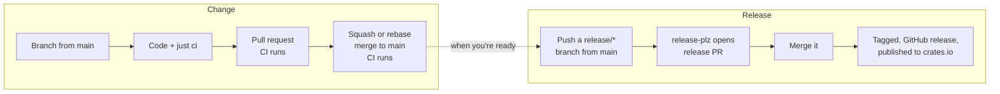

# Rust library template

A template for starting a new Rust library crate with everything around the
code already set up: formatting, linting, tests, coverage, dependency
auditing, CI, automated dependency updates and releases to crates.io.

You generate a new project from it with
[cargo-generate](https://cargo-generate.github.io/cargo-generate/), answer a
few questions, and get a crate that passes all its checks from the first
commit.

The core idea: **one devcontainer image and one set of commands, used
everywhere.** Every tool is pinned inside a container image. You develop in
that image and CI runs in that same image. Every check is a `just` command,
so whatever passes on your machine passes in CI.

## What you get

- **Crate setup:** edition 2024, a minimum supported Rust version of about
  six months back, strict lints, docs built the way docs.rs builds them.
- **Checks:** formatting, lints, spelling, tests, coverage, oldest supported
  Rust version, feature combinations, dependency licenses and advisories,
  breaking-API detection, workflow security.
- **One command per check:** `just lint`, `just test` and so on; `just ci`
  runs them all, exactly as CI does.
- **Devcontainer:** every toolchain and tool at pinned versions, used both
  locally and by CI.
- **Automation:** CI on every pull request and merge, a protected `main`
  (squash or rebase merges only), a weekly run against new Rust and
  dependency releases, Renovate update PRs, and releases to crates.io
  started by pushing a `release/*` branch.
- **Optional extras:** Miri for `unsafe` code, fuzzing, benchmarks, Codecov.

## Getting started

### Prerequisites

| You need | For |
|---|---|
| [Rust](https://rustup.rs) | Running cargo-generate on your machine |
| [cargo-generate](https://cargo-generate.github.io/cargo-generate/) 0.26+ | Creating projects: `cargo install cargo-generate` |
| [Docker](https://docs.docker.com/get-docker/) | Running the devcontainer |
| [VS Code](https://code.visualstudio.com) with the [Dev Containers](https://marketplace.visualstudio.com/items?itemName=ms-vscode-remote.remote-containers) extension | Working inside the devcontainer |
| A GitHub account | Hosting the repository and running CI |
| A [crates.io](https://crates.io) account (sign in with GitHub) | Publishing the crate |

### 1. Generate the project

```sh
cargo generate --git https://github.com/sreea05/rust
```

You'll be asked for:

| Prompt | Default | Effect |
|---|---|---|
| Project name | — | Crate and repository name |
| Description | `A Rust library` | Cargo.toml, README, crate docs |
| GitHub owner | `sreea05` | Repository URLs, badges, CODEOWNERS, license |
| Uses `unsafe`? | no | No: unsafe code is forbidden. Yes: allowed per module with `// SAFETY:` comments, checked by Miri |
| Fuzzing? | no | `fuzz/` with a fuzz target, run in CI |
| Benchmarks? | yes | `benches/` with a criterion benchmark |
| Codecov? | no | Coverage uploads to Codecov, plus a badge |

Skip the prompts by passing answers, e.g. `-d uses_unsafe=true -d fuzzing=false`.

### 2. Open it in the devcontainer

Open the new folder in VS Code and choose **Reopen in Container**. The first
build downloads and installs every toolchain and tool, which takes several
minutes; later starts are instant. When it finishes, `just setup` has
already run: `Cargo.lock` exists and the git hooks are installed.

In the container's terminal, confirm everything passes:

```sh
just ci
```

Run `just` on its own to see every available command.

### 3. Replace the example code

The project ships with a small example function, `checked_add`, so every
tool has something to work on. Replace it with your own code in:

- `src/lib.rs`: the library and its unit tests
- `tests/api.rs`: integration tests
- `examples/basic.rs`: a runnable example
- `README.md`: the usage example (it's tested, so it must compile)
- `benches/checked_add.rs` and `fuzz/fuzz_targets/checked_add.rs`, if you
  enabled them (rename them, and update their names in `Cargo.toml` and
  `fuzz/Cargo.toml`)

Run `just ci` again when you're done.

### 4. Put it on GitHub

Work through the [new repository checklist](#new-repository-checklist):
create the repository, push, and connect the services. The first CI run
builds the devcontainer image on GitHub (several minutes, once); later runs
reuse it.

### 5. Release

Publish the first version by hand, as described in
[Before the first release](#before-the-first-release). After that, every
release starts with a `release/*` branch (see below).

## Day-to-day workflow



1. **Work on a branch,** never on `main`: `main` only accepts pull
   requests. Run `just ci` before pushing; the git hook checks formatting
   and spelling on every commit.
2. **Write commit messages** as [Conventional Commits](https://www.conventionalcommits.org/)
   (`feat: ...`, `fix: ...`). They decide the next version number and
   become the changelog.
3. **Open a pull request.** CI runs every check in the devcontainer image.
   Merge with **squash** or **rebase** once it passes (merge commits are
   blocked); CI runs again on `main`.
4. **Release when you choose:** push a branch named `release/<anything>`
   from `main`. release-plz bumps the version, updates the changelog and
   opens a release PR. Merging it publishes to crates.io and creates a
   GitHub release. Ordinary merges never release.
5. **Dependency updates** arrive as Renovate PRs on Monday mornings. Review
   and merge them like any other PR.

## New repository checklist

### Once, before your first crate

- [ ] **Create the release bot** (required for releases). GitHub doesn't
  run CI on commits and pull requests made by a workflow's built-in token,
  so a release PR could never pass the checks `main` requires. A GitHub App
  (a bot account you own) avoids that, and one app serves all your
  repositories:
  1. GitHub → your profile → *Settings* → *Developer settings* →
     *GitHub Apps* → *New GitHub App*.
  2. Name it (e.g. `sreea05-release-bot`), set any homepage URL, and untick
     *Webhook → Active*.
  3. Under *Repository permissions* set **Contents** and **Pull requests**
     to *Read and write*. Choose *Only on this account*, then *Create*.
  4. Note the **Client ID** and click *Generate a private key* (downloads a
     `.pem` file). Keep both; every repository needs them.

### For each new repository

- [ ] **Open the project in the devcontainer** (or run `just setup`). This
  creates `Cargo.lock` and installs the git hooks.
- [ ] **Fill in `keywords` and `categories`** in `Cargo.toml` so the crate
  can be found on crates.io (up to 5 of each; categories must come from
  <https://crates.io/category_slugs>).
- [ ] **Create the GitHub repository** with the project's name (empty, no
  README or license), then commit everything, **including `Cargo.lock`**,
  and push to `main`. CI fails without `Cargo.lock`.
- [ ] **Make the devcontainer package public** (public repositories only).
  The first CI run creates it: repository → *Packages* → *devcontainer* →
  *Package settings* → *Change visibility*. This lets PRs from forks use it.
- [ ] **Enable private vulnerability reporting:** repository → *Settings* →
  *Advanced Security* (*Code security* on some accounts) → *Private
  vulnerability reporting* → *Enable*. The project's `SECURITY.md` points
  reporters there.
- [ ] **Install Renovate** for the repository: <https://github.com/apps/renovate>
  → *Configure* → add the repository.
- [ ] **Connect the release bot:** install your GitHub App on the repository
  (app settings → *Install App*), then in the repository → *Settings* →
  *Secrets and variables* → *Actions* add:
  - the **variable** `RELEASE_APP_CLIENT_ID` with the Client ID;
  - the **secret** `RELEASE_APP_PRIVATE_KEY` with the whole `.pem` file.
- [ ] **Protect `main`:** repository → *Settings* → *Rules* → *Rulesets* →
  *New ruleset* → *Import a ruleset* → choose `.github/rulesets/main.json`
  → *Create*. This blocks direct pushes, allows only squash and rebase
  merges of pull requests, and requires CI to pass.
- [ ] **Tidy the merge settings:** repository → *Settings* → *General* →
  *Pull Requests*: untick *Allow merge commits* (the ruleset blocks them
  anyway) and tick *Automatically delete head branches*, so merged and
  release branches are cleaned up.
- [ ] **Connect Codecov** (if enabled): sign in at <https://codecov.io> with
  GitHub, add the repository, and save its upload token as the repository
  secret `CODECOV_TOKEN`. Until then the upload step is skipped.

### Before the first release

- [ ] **Publish the first version by hand.** Publishing from CI only works
  for crates that already exist on crates.io. From an up-to-date `main`:
  `cargo login` (token from <https://crates.io/settings/tokens>), then
  `cargo publish`.
- [ ] **Enable trusted publishing:** on crates.io, the crate → *Settings* →
  *Trusted Publishing* → *Add*: your GitHub owner and repository name,
  workflow `release-plz.yml`, environment empty. From then on, releases
  start with a `release/*` branch
  ([how](CONTRIBUTING.md#releases)).

## Where to find what

| To find out | Look at |
|---|---|
| What the template gives you and how to start | This README |
| How a generated project works: every command, workflow, rule and tool | `CONTRIBUTING.md` in the project ([template version](CONTRIBUTING.md), with raw placeholders) |
| The available commands | Run `just` in the project |
| Tool versions | `.devcontainer/tools.toml` and `rust-toolchain.toml` |

## Working on the template

Files are copied into generated projects with `{{placeholders}}` filled in,
so the template itself doesn't build. A few files are stored under other
names and renamed by `post-generate.rhai`, so they don't affect this
repository:

| In this repository | In generated projects |
|---|---|
| `README.project.md` | `README.md` |
| `LICENSE.project` | `LICENSE` |
| `.github-project/` | `.github/` |

Install [Renovate](https://github.com/apps/renovate) on this repository too,
so the pinned versions here (actions, tools, base image, toolchain) stay
current and new projects start up to date. Renovate can't parse the
templated `Cargo.toml`, so dependencies there are updated in each project
instead.

The **Template** workflow (`.github/workflows/template.yml`) tests every
change: it audits the workflows, generates a minimal and a full project, and
runs all their checks in their devcontainer. To do the same locally
(`--path .` copies your working copy as it is, including uncommitted and
untracked files):

```sh
cargo generate --path . --name demo-lib -d description=Demo -d github_owner=you \
  -d uses_unsafe=true -d fuzzing=true -d benchmarks=true -d codecov=true
cd demo-lib
docker build -f .devcontainer/Dockerfile -t demo-lib-dev .
docker run --rm -v "$PWD":/work -w /work demo-lib-dev bash -c 'just setup && just ci'
```
