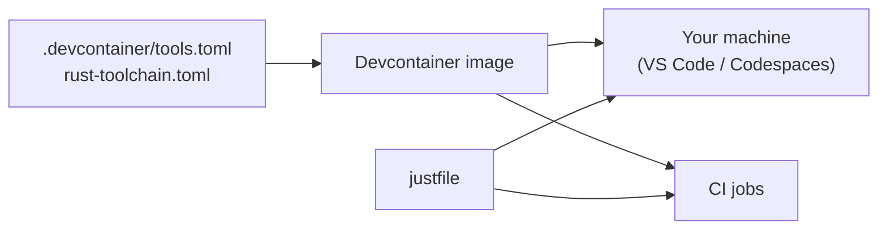
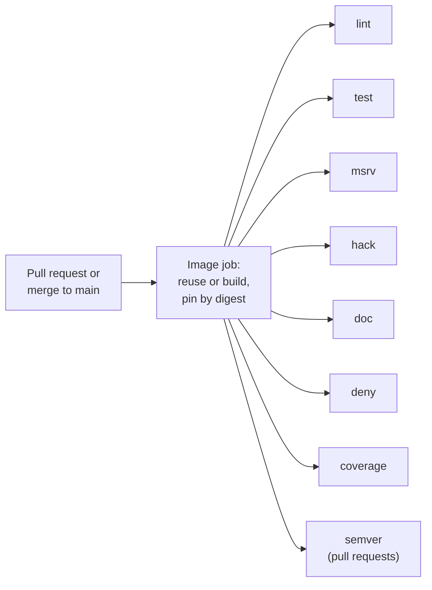
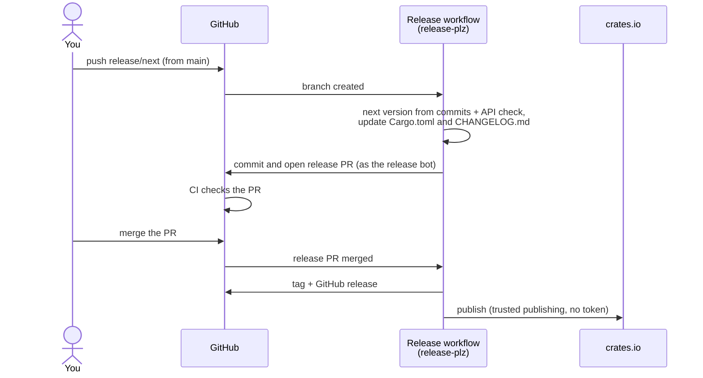
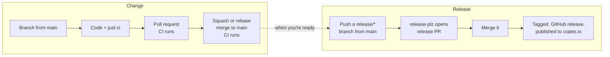

# Rust library template

A template for starting a Rust library crate with everything around the code
already in place: formatting, linting, testing, coverage, dependency
auditing, continuous integration, branch protection, automated dependency
updates, and releases to crates.io.

You create a new project from it with
[cargo-generate](https://cargo-generate.github.io/cargo-generate/), answer a
few questions, and get a crate that passes all its checks from the first
commit. This README explains what the template provides, how it works, and
how to start a new crate with it.

**Contents**

1. [Why this template](#why-this-template)
2. [Features](#features)
3. [How it works](#how-it-works)
4. [Getting started](#getting-started)
5. [Day-to-day workflow](#day-to-day-workflow)
6. [New repository checklist](#new-repository-checklist)
7. [Troubleshooting](#troubleshooting)
8. [Where to find what](#where-to-find-what)
9. [Working on the template](#working-on-the-template)

## Why this template

Setting up a Rust library properly takes far longer than writing its first
function: choosing and configuring a dozen tools, writing CI, protecting the
main branch, automating releases, and keeping all of it up to date. Doing
that by hand for every crate leads to projects that drift apart and checks
that pass locally but fail in CI.

This template does it once, consistently, around one idea: **one
development image and one set of commands, used everywhere.**

- Every toolchain and tool is pinned to an exact version inside a
  container image (the *devcontainer*).
- You develop inside that image, and CI runs inside that same image.
- Every check is a [`just`](https://just.systems) command, and CI runs the
  same commands.

So whatever passes on your machine passes in CI, and a CI failure can be
reproduced locally with one command.

## Features

Every feature below is explained in detail (what it does, how to use it,
how to change it) in [CONTRIBUTING.md](CONTRIBUTING.md), which every
generated project gets with its own names filled in.

| Area | What you get |
|---|---|
| **Crate setup** | Edition 2024; a minimum supported Rust version (MSRV) of about six months back; strict lints (clippy pedantic, documented public API, no leftover debug code); docs.rs configuration; a tested README example; MIT license |
| **[Formatting](CONTRIBUTING.md#formatting)** | rustfmt for Rust, taplo for TOML, editorconfig for every editor; format-on-save in VS Code |
| **[Linting](CONTRIBUTING.md#lints)** | clippy with every warning treated as an error; `unsafe` forbidden (or allowed per module with mandatory safety comments) |
| **[Spelling](CONTRIBUTING.md#spelling)** | typos checks code, comments and docs |
| **[Tests](CONTRIBUTING.md#tests)** | cargo-nextest for unit and integration tests, plus doc tests and README examples |
| **[Coverage](CONTRIBUTING.md#coverage)** | cargo-llvm-cov, with a summary on every CI run; optional Codecov upload |
| **[MSRV check](CONTRIBUTING.md#minimum-supported-rust-version-msrv)** | Builds with the oldest supported Rust version to keep that promise honest |
| **[Feature combinations](CONTRIBUTING.md#feature-combinations)** | cargo-hack checks every combination of Cargo features |
| **[Docs](CONTRIBUTING.md#documentation)** | Built exactly as docs.rs builds them, with warnings as errors |
| **[Dependency audit](CONTRIBUTING.md#dependency-audit)** | cargo-deny rejects known vulnerabilities, yanked crates, disallowed licenses and unknown sources |
| **[API compatibility](CONTRIBUTING.md#api-compatibility-semver)** | cargo-semver-checks flags breaking API changes on every pull request and when choosing release versions |
| **[Workflow security](CONTRIBUTING.md#workflow-audit)** | zizmor audits every GitHub Actions workflow |
| **[Commands](CONTRIBUTING.md#commands)** | A `just` command for every check; `just ci` runs them all, exactly as CI does |
| **[Git hook](CONTRIBUTING.md#making-a-change)** | lefthook checks formatting and spelling before each commit |
| **[Devcontainer](CONTRIBUTING.md#the-devcontainer)** | Every toolchain and tool at pinned versions, for VS Code and GitHub Codespaces, reused by CI |
| **[CI](CONTRIBUTING.md#ci-workflows)** | Runs every check on every pull request and merge, in parallel, inside the devcontainer image |
| **[Weekly checks](CONTRIBUTING.md#details)** | Tests against Rust beta and nightly and the newest dependencies; re-audits dependencies; refreshes the image |
| **[Protected `main`](CONTRIBUTING.md#the-protected-main-branch)** | No direct pushes; squash or rebase merges of pull requests only; CI must pass |
| **[Releases](CONTRIBUTING.md#releases)** | Started by pushing a `release/*` branch; release-plz picks the version from commit messages, writes the changelog, and publishes to crates.io without stored tokens |
| **[Dependency updates](CONTRIBUTING.md#dependency-updates)** | Renovate proposes weekly updates for crates, actions, tools, the base image and the toolchain, after a 14-day waiting period |
| **[Security](CONTRIBUTING.md#security-measures)** | Everything pinned (actions by commit, images by digest); least-privilege workflows; verified downloads; private vulnerability reporting |
| **Project files** | Issue and pull request templates, CODEOWNERS, SECURITY.md, CODE_OF_CONDUCT.md, CHANGELOG.md |
| **Optional extras** | Chosen when generating: [Miri](CONTRIBUTING.md#miri) for `unsafe` code, [fuzzing](CONTRIBUTING.md#fuzzing), [benchmarks](CONTRIBUTING.md#benchmarks), Codecov |

## How it works

### 1. Generating a project

`cargo generate` copies this repository into a new folder and fills in
placeholders such as the crate name, description and GitHub owner. Your
answers to the yes/no prompts decide which optional files are included:

| Prompt answered "yes" | Adds |
|---|---|
| Uses `unsafe`? | Stricter `unsafe` lints instead of a ban, the Miri workflow and `just miri` |
| Fuzzing? | The `fuzz/` crate, the Fuzz workflow and `just fuzz` |
| Benchmarks? | `benches/` with a criterion benchmark and `just bench` |
| Codecov? | `codecov.yml`, a Codecov badge and upload instructions |

The documentation in the new project only describes the extras you chose.
The new folder also gets a fresh git repository.

### 2. One image, one set of commands



- **The image** (`.devcontainer/`) contains the pinned stable Rust, the MSRV
  toolchain, a pinned nightly, and every tool, at the versions listed in
  `.devcontainer/tools.toml`.
- **The commands** (`justfile`) define every check once: `just lint`,
  `just test`, `just ci` and so on.
- **CI** builds the same image (once, then reuses it) and runs the same
  commands in it.

### 3. Continuous integration



Each check runs as its own job, in parallel, so a failure names exactly
which check failed. Miri and fuzzing, if enabled, run as separate
workflows. A weekly scheduled workflow tests against upcoming Rust versions
and the newest dependencies, re-audits dependencies, rebuilds the image
with fresh security updates, and cleans up old images.

### 4. The protected `main` branch

Each project includes a GitHub ruleset (`.github/rulesets/main.json`) that
you import once. It makes pull requests the only way to change `main`,
allows only squash or rebase merges (so history stays linear), requires CI
to pass, and applies to everyone, including administrators.

### 5. Releases

Releases happen only when you start one, by pushing a branch whose name
starts with `release/`:



The version number comes from [Conventional Commit](https://www.conventionalcommits.org/)
messages (`feat:`, `fix:`, `feat!:` …) and is double-checked with
cargo-semver-checks. A small GitHub App you own (the *release bot*) opens
the release pull request, because GitHub doesn't run CI for pull requests
opened with a workflow's own token.

### 6. Staying up to date

Renovate opens pull requests every Monday for new versions of crates,
GitHub Actions, the tools in `tools.toml`, the devcontainer base image and
the Rust toolchain, each at least 14 days old. CI checks them like any
other pull request. Installing Renovate on this template repository as well
keeps the template's own pins current, so new projects start up to date.

### 7. Security

Every external piece is pinned: actions to exact commits, images to
digests, tools and toolchains to exact versions, with checksums verified
where they're published. Workflows run with the fewest permissions they
need and are audited by zizmor. crates.io publishing uses trusted
publishing, so no long-lived token exists to leak. Details:
[Security measures](CONTRIBUTING.md#security-measures).

## Getting started

### Prerequisites

| You need | For |
|---|---|
| [Rust](https://rustup.rs) | Running cargo-generate on your machine |
| [cargo-generate](https://cargo-generate.github.io/cargo-generate/) 0.26+ | Creating projects: `cargo install cargo-generate` |
| [Docker](https://docs.docker.com/get-docker/) | Running the devcontainer |
| [VS Code](https://code.visualstudio.com) with the [Dev Containers](https://marketplace.visualstudio.com/items?itemName=ms-vscode-remote.remote-containers) extension | Working inside the devcontainer (or use GitHub Codespaces instead of Docker and VS Code) |
| A GitHub account | Hosting the repository, CI, the release bot |
| A [crates.io](https://crates.io) account (sign in with GitHub) | Publishing the crate |

### 1. Generate the project

```sh
cargo generate --git https://github.com/sreea05/rust
```

You'll be asked for:

| Prompt | Default | Effect |
|---|---|---|
| Project name | — | Crate and repository name |
| Description | `A Rust library` | `Cargo.toml`, README, crate docs |
| GitHub owner | `sreea05` | Repository URLs, badges, CODEOWNERS, license |
| Uses `unsafe`? | no | No: unsafe code is forbidden. Yes: allowed per module with `// SAFETY:` comments, checked by Miri |
| Fuzzing? | no | `fuzz/` with a fuzz target, run in CI |
| Benchmarks? | yes | `benches/` with a criterion benchmark |
| Codecov? | no | Coverage uploads to Codecov, plus a badge |

Skip the prompts by passing answers, e.g.
`cargo generate --git https://github.com/sreea05/rust --name my-crate -d description="Does a thing" -d uses_unsafe=false -d fuzzing=false -d benchmarks=true -d codecov=false`.

### 2. Open it in the devcontainer

Open the new folder in VS Code and choose **Reopen in Container**. The first
build downloads and installs every toolchain and tool, which takes several
minutes; later starts are instant. When it finishes, `just setup` has
already run: `Cargo.lock` exists and the git hook is installed.

In the container's terminal, confirm everything passes:

```sh
just ci
```

Run `just` on its own to see every available command.

### 3. Replace the example code

The project ships with a small example function, `checked_add`, so every
tool has something to work on. Replace it with your own code in:

- `src/lib.rs`: the library and its unit tests
- `tests/api.rs`: integration tests
- `examples/basic.rs`: a runnable example
- `README.md`: the usage example (it's tested, so it must compile)
- `benches/checked_add.rs` and `fuzz/fuzz_targets/checked_add.rs`, if you
  enabled them (rename them, and update their names in `Cargo.toml` and
  `fuzz/Cargo.toml`)

Run `just ci` again when you're done.

### 4. Put it on GitHub

Work through the [new repository checklist](#new-repository-checklist):
create the repository, push, protect `main`, and connect the services. The
first CI run builds the devcontainer image on GitHub (several minutes,
once); later runs reuse it.

### 5. Release

Publish the first version by hand, as described in
[Before the first release](#before-the-first-release). After that, every
release starts with a `release/*` branch (see below).

## Day-to-day workflow



1. **Work on a branch,** never on `main`: `main` only accepts pull
   requests. Run `just ci` before pushing; the git hook checks formatting
   and spelling on every commit.
2. **Write commit messages** as [Conventional Commits](https://www.conventionalcommits.org/)
   (`feat: ...`, `fix: ...`). They decide the next version number and
   become the changelog. With squash merges, the pull request title becomes
   the commit message, so give it the right type too.
3. **Open a pull request.** CI runs every check in the devcontainer image.
   Merge with **squash** or **rebase** once it passes (merge commits are
   blocked); CI runs again on `main`.
4. **Release when you choose:** push a branch named `release/<anything>`
   from `main`. release-plz bumps the version, updates the changelog and
   opens a release PR. Merging it publishes to crates.io and creates a
   GitHub release. Ordinary merges never release.
5. **Dependency updates** arrive as Renovate PRs on Monday mornings. Review
   and merge them like any other PR.

The full step-by-step guide is in [Making a change](CONTRIBUTING.md#making-a-change)
and [Releases](CONTRIBUTING.md#releases).

## New repository checklist

### Once, before your first crate

- [ ] **Create the release bot** (required for releases). GitHub doesn't
  run CI on commits and pull requests made by a workflow's built-in token,
  so a release PR could never pass the checks `main` requires. A GitHub App
  (a bot account you own) avoids that, and one app serves all your
  repositories:
  1. GitHub → your profile → *Settings* → *Developer settings* →
     *GitHub Apps* → *New GitHub App*.
  2. Name it (e.g. `sreea05-release-bot`), set any homepage URL, and untick
     *Webhook → Active*.
  3. Under *Repository permissions* set **Contents** and **Pull requests**
     to *Read and write*. Choose *Only on this account*, then *Create*.
  4. Note the **Client ID** and click *Generate a private key* (downloads a
     `.pem` file). Keep both; every repository needs them.

### For each new repository

- [ ] **Open the project in the devcontainer** (or run `just setup`). This
  creates `Cargo.lock` and installs the git hook.
- [ ] **Fill in `keywords` and `categories`** in `Cargo.toml` so the crate
  can be found on crates.io (up to 5 of each; categories must come from
  <https://crates.io/category_slugs>).
- [ ] **Create the GitHub repository** with the project's name (empty, no
  README or license), then commit everything, **including `Cargo.lock`**,
  and push to `main`. CI fails without `Cargo.lock`.
- [ ] **Make the devcontainer package public** (public repositories only).
  The first CI run creates it: repository → *Packages* → *devcontainer* →
  *Package settings* → *Change visibility*. This lets PRs from forks use it.
- [ ] **Enable private vulnerability reporting:** repository → *Settings* →
  *Advanced Security* (*Code security* on some accounts) → *Private
  vulnerability reporting* → *Enable*. The project's `SECURITY.md` points
  reporters there.
- [ ] **Install Renovate** for the repository: <https://github.com/apps/renovate>
  → *Configure* → add the repository.
- [ ] **Connect the release bot:** install your GitHub App on the repository
  (app settings → *Install App*), then in the repository → *Settings* →
  *Secrets and variables* → *Actions* add:
  - the **variable** `RELEASE_APP_CLIENT_ID` with the Client ID;
  - the **secret** `RELEASE_APP_PRIVATE_KEY` with the whole `.pem` file.
- [ ] **Protect `main`:** repository → *Settings* → *Rules* → *Rulesets* →
  *New ruleset* → *Import a ruleset* → choose `.github/rulesets/main.json`
  → *Create*. This blocks direct pushes, allows only squash and rebase
  merges of pull requests, and requires CI to pass. Do this after the first
  push, because it blocks pushing to `main`.
- [ ] **Tidy the merge settings:** repository → *Settings* → *General* →
  *Pull Requests*: untick *Allow merge commits* (the ruleset blocks them
  anyway) and tick *Automatically delete head branches*, so merged and
  release branches are cleaned up.
- [ ] **Connect Codecov** (if enabled): sign in at <https://codecov.io> with
  GitHub, add the repository, and save its upload token as the repository
  secret `CODECOV_TOKEN`. Until then the upload step is skipped.

### Before the first release

- [ ] **Publish the first version by hand.** Publishing from CI only works
  for crates that already exist on crates.io. From an up-to-date `main`:
  `cargo login` (token from <https://crates.io/settings/tokens>), then
  `cargo publish`.
- [ ] **Enable trusted publishing:** on crates.io, the crate → *Settings* →
  *Trusted Publishing* → *Add*: your GitHub owner and repository name,
  workflow `release-plz.yml`, environment empty. From then on, releases
  start with a `release/*` branch
  ([how](CONTRIBUTING.md#releases)).

## Troubleshooting

Problems specific to a generated project (failing checks, releases, CI) are
covered in its [Troubleshooting](CONTRIBUTING.md#troubleshooting) section.
Problems with creating a project:

**`cargo generate` refuses to run the template.**
It needs cargo-generate 0.26 or newer: `cargo install cargo-generate --force`.

**The generated project contains `README.project.md`, `LICENSE.project` or
`.github-project/`.**
The post-generation script didn't run, which means cargo-generate is too
old. Update it and generate again.

**The first devcontainer build takes a long time.**
It installs three Rust toolchains and about a dozen tools. Without a GitHub
token, GitHub's API rate limit can force some tools to be compiled from
source. It completes; later builds are cached.

**The first push to `main` is rejected.**
The ruleset is already active. Push before importing it, or temporarily
disable it (*Settings* → *Rules* → *Rulesets*).

## Where to find what

| To find out | Look at |
|---|---|
| What the template is, how it works, how to start | This README |
| How a generated project works: every command, check, workflow, rule and tool, and how to change each | `CONTRIBUTING.md` in the project ([template version](CONTRIBUTING.md), with raw placeholders) |
| The available commands | Run `just` in the project |
| Tool versions | `.devcontainer/tools.toml` and `rust-toolchain.toml` |
| What the crate's users see | `README.md` in the project ([template version](README.project.md)) |

## Working on the template

### How the repository is laid out

Most files at the root are the template: they're copied into generated
projects, with `{{placeholders}}` and `` blocks filled in. That's
why the template itself doesn't build. A few files exist in two versions:

| In this repository | Becomes, in generated projects | Why two versions |
|---|---|---|
| `README.md` (this file) | not copied | The template's own README |
| `README.project.md` | `README.md` | The crate's README |
| `LICENSE` | not copied | The template's own license |
| `LICENSE.project` | `LICENSE` | Filled in with the year and owner |
| `.github/` | not copied | The template's own workflow |
| `.github-project/` | `.github/` | So GitHub doesn't run the project workflows here |

`post-generate.rhai` does the renames. Template-only settings are in
`cargo-generate.toml`: the prompts, which files to skip for each "no"
answer, and which files to copy without filling in placeholders (the
workflows, the `justfile` and `release-plz.toml` use `{{ }}` for their own
syntax).

### Making changes

- **Add a tool:** add it to `.devcontainer/tools.toml` with a
  `# renovate:` comment, use it in a `justfile` command, and add it to the
  Tools table in `CONTRIBUTING.md`.
- **Add a prompt:** add a `[placeholders.<name>]` entry in
  `cargo-generate.toml`; use `` in files, or a
  `[conditional.'!<name>']` section to skip whole files; update the prompt
  tables in this README; add the variant to `.github/workflows/template.yml`
  if it needs testing.
- **Update pinned versions:** install [Renovate](https://github.com/apps/renovate)
  on this repository; it updates the actions (including those in
  `.github-project/`), tools, base image and toolchain. Renovate can't parse
  the templated `Cargo.toml`, so crate dependencies there are updated in
  each project instead.

### Testing changes

The **Template** workflow (`.github/workflows/template.yml`) tests every
change: it audits all workflows with zizmor, generates a minimal project
(no extras) and a full one (all extras), builds each one's devcontainer
image, and runs `just setup`, `just ci`, and for the full one also Miri, a
short fuzz run and a benchmark build.

To do the same locally (`--path .` copies your working copy as it is,
including uncommitted and untracked files):

```sh
cargo generate --path . --name demo-lib -d description=Demo -d github_owner=you \
  -d uses_unsafe=true -d fuzzing=true -d benchmarks=true -d codecov=true
cd demo-lib
docker build -f .devcontainer/Dockerfile -t demo-lib-dev .
docker run --rm -v "$PWD":/work -w /work demo-lib-dev bash -c 'just setup && just ci'
```
